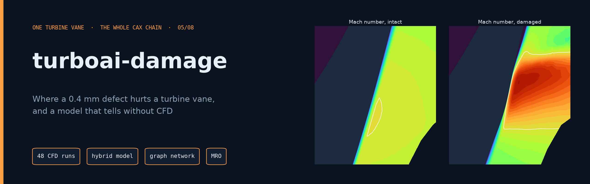
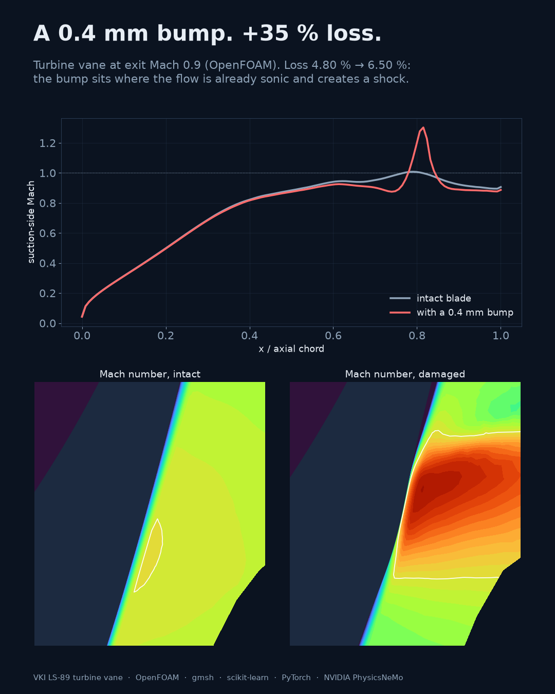
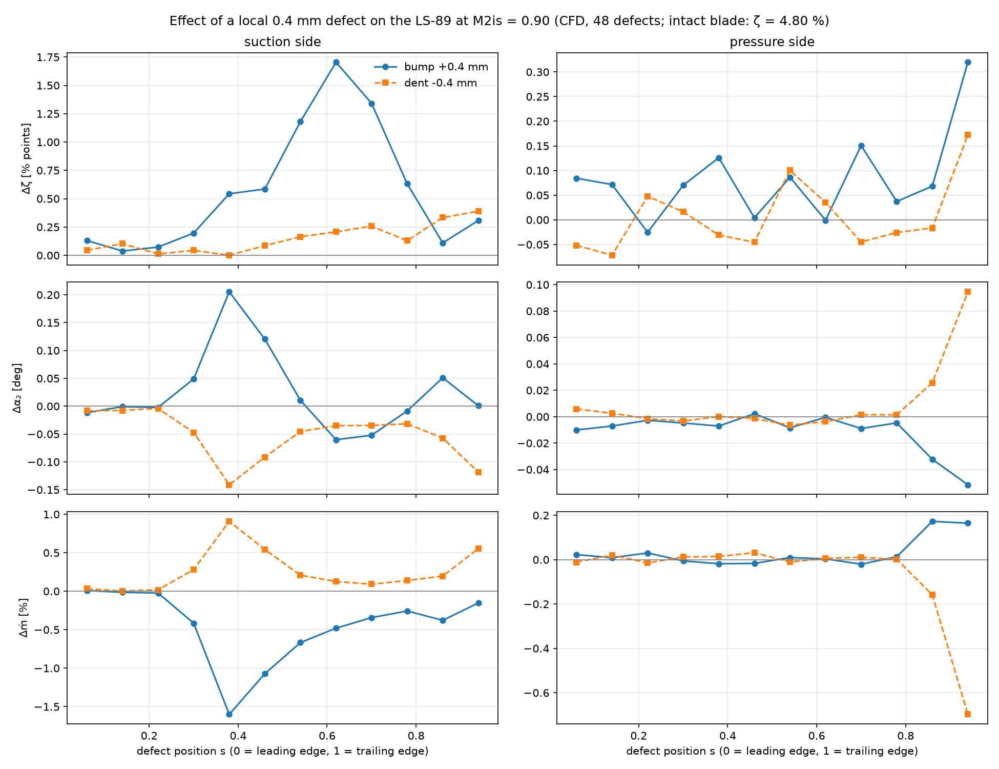
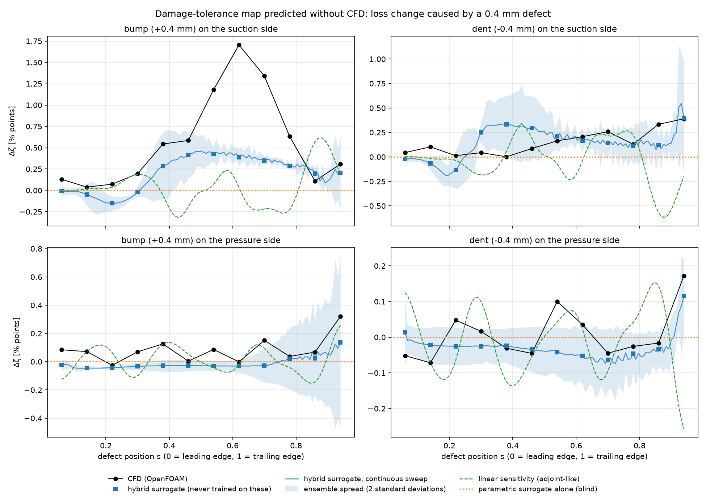

<!-- header:start -->
<p align="center">
  
</p>

<p align="center">
  <a href="https://github.com/ignaciofuertecarrasco/turboai-damage/actions/workflows/ci.yml"></a>
  
  
  
  <a href="LICENSE"></a>
</p>

<p align="center">
  <sub>Part of <a href="https://ignaciofuertecarrasco.github.io/cax-portfolio/"><b>One turbine vane, the whole CAX chain</b></a>: eight small open-source projects around one public turbine benchmark</sub><br>
  <sub><a href="https://github.com/ignaciofuertecarrasco/TurboAI">CFD</a> · <a href="https://github.com/ignaciofuertecarrasco/openfoam-viscous-work">viscous work</a> · <a href="https://github.com/ignaciofuertecarrasco/turboai-surrogates">surrogates</a> · <a href="https://github.com/ignaciofuertecarrasco/turboai-shape-ml">shape ML</a> · <b>damage</b> · <a href="https://github.com/ignaciofuertecarrasco/turboai-agent">agent</a> · <a href="https://github.com/ignaciofuertecarrasco/vane-thermomech">CAD → FEA → CAM</a> · <a href="https://github.com/ignaciofuertecarrasco/cax-components">components</a></sub>
</p>
<!-- header:end -->

**Where does a 0.4 mm defect hurt a turbine vane, and can a model tell without running CFD?
48 OpenFOAM simulations map the damage tolerance of the VKI LS-89; a hybrid surrogate (Gaussian processes +
a graph network on the blade surface) predicts the same map in 80 ms per position.**

<!-- glance:start -->
## At a glance

| **48** | **+35 %** | **r = 0.70** | **80 ms** |
|:-:|:-:|:-:|:-:|
| CFD runs of a 0.4 mm bump or dent along the blade | loss from one bump on the rear suction side | hybrid model vs CFD on unseen defects (0.78 blind) | per defect position, instead of a CFD run |
<!-- glance:end -->




## The question

Real blades are not the nominal shape: erosion, deposits, foreign-object damage and manufacturing tolerances
leave local bumps and dents. Which ones matter? The answer decides inspection intervals, repair limits and
manufacturing tolerances, and normally needs one CFD run per defect.

## The CFD answer: a damage-tolerance map

A smooth bump (+0.4 mm) or dent (-0.4 mm), 5 % of the surface length wide, placed at 12 positions on each side
of the blade at exit Mach 0.9: 48 RANS simulations with the [TurboAI](https://github.com/ignaciofuertecarrasco/TurboAI) CFD.



* The **pressure side** tolerates defects almost everywhere (< 0.15 % points of loss).
* On the **rear suction side**, where the flow is already close to sonic, a bump triggers a supersonic pocket
  closed by a shock: the loss rises from 4.80 % to 6.50 % (+35 %) for a 0.4 mm bump.
* The response is strongly non-linear: a bump and a dent at the same place do not give opposite effects, and
  a linear (adjoint-like) sensitivity does not correlate with the CFD (r ≈ -0.14).

## The model: nominal + deviation

```
blade outline ──► robust fit of the nominal family shape ──► Gaussian processes ──► nominal loading, loss
       │                                                                                  │
       └──► deviation from the nominal (normal offset along the surface) ──► graph network ┴──► + correction
```

The Gaussian processes of [turboai-shape-ml](https://github.com/ignaciofuertecarrasco/turboai-shape-ml) know the family; a small
graph network on the blade surface (message passing along the wall, an ensemble of three) learns how a local
deviation changes the loading and the loss. It works on any outline, including a measured one, because the
nominal shape is recovered by a fit that ignores the defect.



On the 48 defects above and on 8 further "blind" defects of other widths, none of which was in its training data:

| | hybrid model | parametric surrogate alone |
|---|---|---|
| loading change ΔMis near the defect, mean error | **0.013** (4× smaller) | 0.055 (blind to the defect) |
| loss change Δζ, correlation with CFD | **r = 0.70** (48-defect map), **0.78** (blind set) | 0 |
| loading error on out-of-family blades | **0.0052** (-41 %) | 0.0088 |
| loading error on in-family test blades | 0.0053 | **0.0047** |
| cost | 80 ms per position | 1 ms |

A linear (adjoint-like) sensitivity of the loss to the surface shape gives r ≈ -0.14 on the same map. The
hybrid model pays a small price inside the family, where the parametric model is already exact.

What it does not do yet: it underestimates the largest, shock-induced peak (1.7 % points predicted as about
0.5); the ensemble spread does widen there, which tells the user to run the CFD.

## Quick start

```bash
pip install -e .        # plus turboai (core) and turboai-shape-ml (nominal models)
python -m turboai_damage.deviation_model predict --bump lower,0.62,0.05,0.006 --M2is 0.9
python -m turboai_damage.deviation_model predict --params a2=0.01 --bump upper,0.40,0.05,-0.004 --png loading.png
python -m turboai_damage.defect_map         # the 48-case CFD map (OpenFOAM, about 3 h on 8 cores)
python -m turboai_damage.deviation_model evaluate
python -m turboai_damage.paper_stats        # bootstrap confidence intervals of every reported number
```

`--bump side,s0,width,amplitude`: side `lower` = suction, `upper` = pressure; s0 and width as fractions of
the surface length; amplitude as a fraction of the axial chord (0.006 × 67.5 mm ≈ 0.4 mm).

## Repository layout

| path | |
|---|---|
| `turboai_damage/defect_map.py` | CFD campaign over defect position, sign and side; mechanism figures |
| `turboai_damage/deviation_model.py` | hybrid model: robust nominal fit, surface graph network, ensemble, CLI |
| `turboai_damage/paper_stats.py` | bootstrap statistics |
| `results/` | CFD map, trained ensemble, metrics, figures |

<!-- footer:start -->
## The series

| # | Project | Question |
|:-:|---|---|
| 1 | [TurboAI](https://github.com/ignaciofuertecarrasco/TurboAI) | OpenFOAM CFD of a transonic vane, checked against the wind tunnel, with a Python API |
| 2 | [openfoam-viscous-work](https://github.com/ignaciofuertecarrasco/openfoam-viscous-work) | Viscous heating in the rhoSimpleFoam energy equation, added as an fvOption |
| 3 | [turboai-surrogates](https://github.com/ignaciofuertecarrasco/turboai-surrogates) | How few CFD runs does a millisecond surrogate need? |
| 4 | [turboai-shape-ml](https://github.com/ignaciofuertecarrasco/turboai-shape-ml) | Gaussian processes or a graph network over blade shape? Design checked by CFD |
| 5 | **turboai-damage** (this one) | Where does a 0.4 mm defect hurt, and can a model tell without CFD? |
| 6 | [turboai-agent](https://github.com/ignaciofuertecarrasco/turboai-agent) | The toolbox as typed tools for an LLM agent (MCP) |
| 7 | [vane-thermomech](https://github.com/ignaciofuertecarrasco/vane-thermomech) | CAD → mesh → thermal, static and modal FEA of the cooled vane, CAM, ML data set |
| 8 | [cax-components](https://github.com/ignaciofuertecarrasco/cax-components) | CFD, FEA and a differentiable surrogate as Tesseract components |

Overview page: https://ignaciofuertecarrasco.github.io/cax-portfolio/

## License

MIT, see [LICENSE](LICENSE). The LS-89 geometry and measurements are from T. Arts et al., VKI TN-174 (1990).
<!-- footer:end -->
